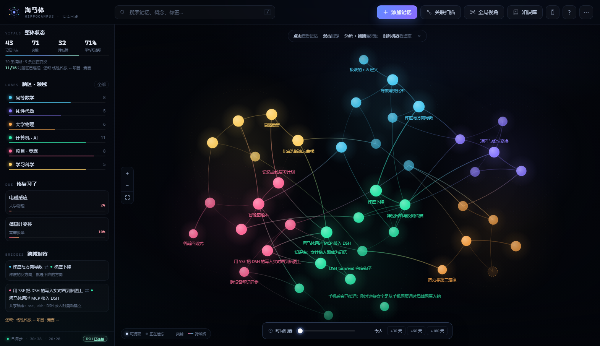
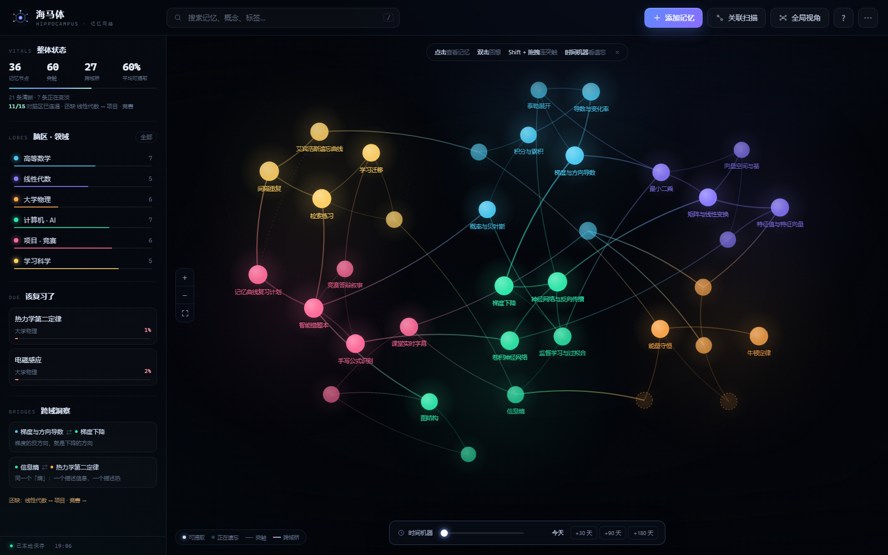
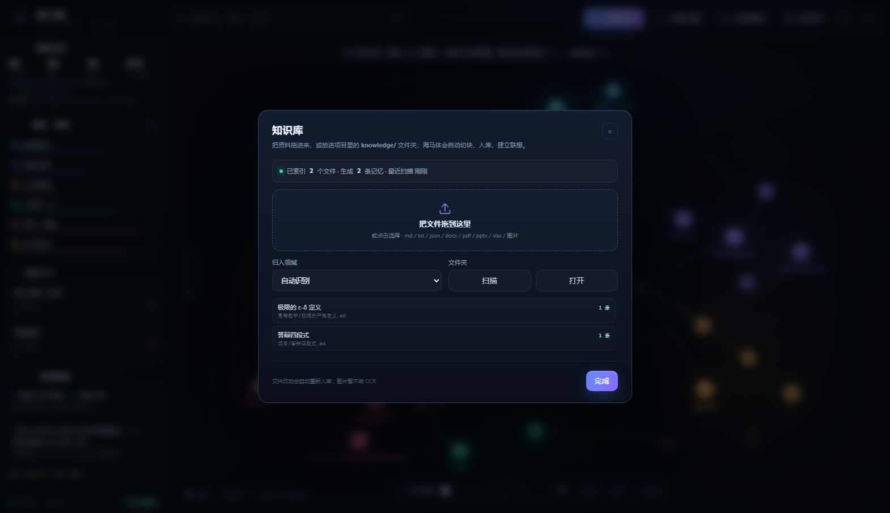
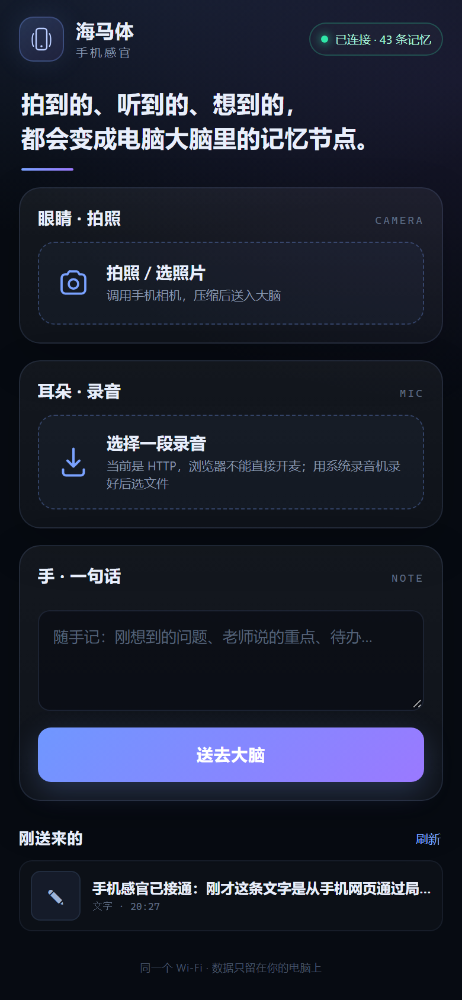

# 海马体 · Hippocampus

> 一个会遗忘、会联想的记忆网络。  
> 这不是「存储笔记」的工具，而是把 AI 助手的记忆做成一张可点击、会变淡、会长出新突触的脑图。

这是「电脑为脑、手机为眼耳、平板为手」整体产品中的**第一块：记忆结构**。  
当前版本先回答一个问题：**如果 AI 真的像一个学生的大脑，它的知识应该长什么样、怎么被调用、怎么被遗忘、又怎么在不同学科之间连起来？**

---

## 已接入 DSH

DSH 通过 **stdio MCP** 直接驱动这个大脑：

- 自动加载 `memory_recall / memory_add / memory_link / memory_stats / memory_due / memory_get / memory_import / memory_import_file / memory_kb_status / memory_sense_recent`；
- 同一个 MCP 进程把脑图托管在 **<http://127.0.0.1:8130/>**；
- AI 写入或调用记忆时，脑图通过 SSE 实时亮起；脑图里的操作也会写回同一份 `data/brain.json`。

### 自动召回 / 自动抽取

工作区的 [AGENTS.md](AGENTS.md) 与 MCP server 的 `instructions` 共同约定每轮行为：

1. 回答前先 `memory_recall`（query 用用户这句话的主题）；
2. 结束前自检：产生新的可复用知识就 `memory_add` 0–1 条；用户说“记住/记一下”时必须保存；
3. 发现明确关系时 `memory_link`。

此外还有一个 **DSH `turn/end` 兜底钩子**（[dsh/plugin](dsh/plugin)）：

- 模型忘了调用 `memory_add` 时，按规则自动捕获“记住”指令、学习型问答（回答 ≥ 240 字）和项目决策；
- 模型本轮已经调用过 `memory_add` → 钩子自动跳过，不重复；
- 只处理 `D:\软件创新大赛` 工作区、非 subagent、正常完成的 turn；
- 写入的节点带 `source.kind=conversation`，详情面板会显示「来源：对话 · 自动捕获」。

所以现在是两层：**模型负责语义抽取，钩子负责兜底**；即使模型忽略协议，会话结束也不会什么都留不下。

在 DSH 对话里直接说：

> 记住：今天我们把海马体接入了 DSH，用 MCP 暴露记忆工具，SSE 实时刷新脑图。  
> 我之前学过傅里叶变换吗？帮我回忆一下。  
> 我的大脑现在什么状态？哪些快忘了？

安装、工具说明、端口与调试见 [dsh/README.md](dsh/README.md)。

```powershell
node dsh/install.mjs desktop        # MCP：记忆工具 + 脑图
node dsh/install-hook.mjs desktop   # turn/end：兜底自动抽取
```



---

## 快速开始

### 方式一：双击启动（推荐）

双击 **`启动海马体.cmd`**，浏览器会自动打开 `http://127.0.0.1:8123/`。  
脚本会优先使用 Python，找不到时回退到 Node，二者都没有时直接打开本地文件（可能无法保存数据）。

### 方式二：手动启动

```powershell
# 在项目目录下
python -m http.server 8123 --bind 127.0.0.1
# 或
node server.js
```

然后访问 <http://127.0.0.1:8123/>。

### 方式三：直接打开

双击 `index.html` 也能运行（实测 Edge 可直接保存；若你的浏览器限制 `file://` 的 localStorage，数据只在当前页面有效，刷新会回到示例脑）。

> 想强制使用浏览器本地数据、不连 DSH：在地址后加 `?local=1`。  
> 想连 DSH 的真实记忆库：直接打开 <http://127.0.0.1:8130/>（DSH 启动后由 MCP server 托管）。  
> 手机感官：同一 Wi-Fi 打开 `http://<电脑局域网IP>:8130/m`，或在脑图顶栏点手机图标扫码。

> 首次打开会加载一套「大二学生学期末」的示例脑：36 个记忆节点、60 条突触、6 个脑区，时间跨度约 4 个月。  
> 独立模式的数据保存在本机浏览器；接入 DSH 后，AI 与脑图共享 `data/brain.json`，不上传任何服务器。

---

## 界面一览



更多：[记忆详情](screenshots/detail.png) · [时间旅行 +90 天](screenshots/time-travel.png) · [全局视角](screenshots/global-view.png) · [自动发现新联系](screenshots/new-connection.png)

---

## 现在能做什么

| 能力 | 实现 |
| --- | --- |
| 记忆节点 | 每个节点包含标题、摘要、领域、概念标签、重要度、编码时间、调用次数、稳定度 |
| 网络可视化 | Canvas 力导向布局：同领域聚成「脑区」，跨领域连线成「桥」 |
| 可点击 | 单击查看记忆详情与遗忘曲线；双击「回想」，沿突触扩散激活 |
| 越久越淡 | `R(t)=e^{-Δt/S}`，亮度 = 当前可提取度；久未调用且调用次数少的节点逐渐变成空心虚线 |
| 越常用越稳 | 每次回想提高稳定度 `S`；间隔越久再回想，提升越大（间隔效应）；一小时内连续点收益递减 |
| 跨域突触 | 共享概念、文本相似、共同邻居三种线索；超过阈值即可建立跨域桥，并保留「为什么连」的理由 |
| 共激活突触 | 45 分钟内先后调用两个记忆，会先长出一条微弱突触，再一次共激活后巩固 |
| 突触衰减 | 长期不用的突触权重衰减并休眠；类型不同，半衰期不同 |
| 时间机器 | 拖动 0–180 天，实时看整张网络如何变淡；「回到今天」一键复原 |
| 全局视角 | 隐去同域连线，只保留跨域桥，看学科之间是否连成一张网 |
| 复习建议 | 按「重要度 × 遗忘程度」排序，列出最该回想的 3 条记忆 |
| 跨域洞察 | 列出最强跨域桥，并显示「6 个脑区 · N/15 对已连通」 |
| 自动记忆 | 每轮先 `memory_recall`；结束前模型自检 `memory_add`；漏掉时 DSH `turn/end` 钩子兜底 |
| 知识库 | `knowledge/` 文件夹监听 + 脑图拖拽上传；md/txt/json/docx/pdf/pptx/xlsx/图片；自动切块、入库、联想 |
| 手机感官 | `/m` 手机页：拍照、录音、文字 → 记忆节点；局域网配对二维码，token 保护 |
| DSH 接入 | stdio MCP 工具（recall / add / link / stats / due / get / import / kb / sense）+ SSE 实时同步 + 共享 `data/brain.json` |
| 数据 | 自动本地保存、JSON 导入导出、重置为示例脑 |

---

## 知识库：文件即记忆

除了在对话里让 AI “记住”，你也可以直接把资料放进知识库。两条路都落到同一份 `data/brain.json`：

### 方式一：放进文件夹

```
knowledge/
├─ 高等数学/
│  └─ 极限的严格定义.md
├─ 项目/
│  └─ 答辩四段式.md
└─ 收件箱/          ← 脑图上传的文件落在这里
```

- 子文件夹名会自动映射到领域（`项目` → 项目·竞赛，`高等数学` → 高等数学）；
- 文件开头可写 front matter：

  ```
  ---
  domain: 高等数学
  tags: [极限, ε-δ]
  importance: 0.6
  ---
  ```

- 支持 `.md .txt .json .docx .pdf .pptx .xlsx` 与图片；
- 修改文件会自动重新切块入库，删除文件会移除对应节点；
- 中文 PDF 依赖 `dsh/vendor/python` 里的 `pypdf`，docx/pptx/xlsx 用 DSH 自带的 Python 运行时。

### 方式二：从脑图拖进去

点顶栏「知识库」→ 把文件拖进虚线框（或点击选择）→ 选择领域（或自动识别）。  
入库时按标题/段落切块（每块约 1400 字），自动建立 1–2 条最强联想，并通过 SSE 让脑图立即亮起。



---

## 手机感官：电脑的眼睛和耳朵

手机不需要装 App：同一个 Wi-Fi 下打开电脑给的配对地址，拍照、录音、写一句话，都会变成脑图里的节点。

### 三步

1. 手机和电脑连同一个 Wi-Fi；
2. 电脑脑图顶栏点 **手机图标** → 手机扫码（或复制地址）；
3. 在手机页里拍照 / 录音 / 写字 → 「送入大脑」。

配对地址形如：

```
http://<电脑局域网IP>:8130/m?token=<配对码>
```

配对码保存在 `data/mobile-token.txt`；地址里已经包含，手机打开一次后会记住。

### 三种感官

| 感官 | 手机页 | 写入的记忆 |
| --- | --- | --- |
| 眼睛 | 调用手机相机；客户端压缩到 1600px / JPEG | `phone-photo`，详情里直接看照片 |
| 耳朵 | HTTPS 或 localhost 可直接开麦；HTTP 下用系统录音机录好再选文件 | `phone-audio`，详情里可播放（支持 Range） |
| 手 | 一句话随手记（也可用输入法语音转文字） | `phone-note` |

手机页是 `/m`，独立静态文件在 [mobile/](mobile)；服务端在 `MCP server` 里：

- `POST /api/sense/photo`（raw image）
- `POST /api/sense/audio`（raw audio，带 duration）
- `POST /api/sense/note`（JSON text）
- `GET /api/sense/recent` · `GET /api/sense/file/<name>`（支持 Range）
- `GET /api/mobile-info` / `GET /api/mobile-qr`（仅本机）

### 让 DSH 看见手机记忆

手机写入后，在 DSH 里说：

> 看看我刚拍的照片。  
> 刚才那段录音是什么？  
> 手机最近送来了什么？

DSH 会调 `memory_sense_recent`；照片的 `source.file` 是电脑上的绝对路径，可以用 `read_image` 读。  
音频暂不做自动转写，先看备注和时长；ASR 是下一步。

### 安全边界

- 为了手机访问，HTTP 服务从 `127.0.0.1` 改为监听 `0.0.0.0`；
- 但**只对局域网开放** `/m` 手机页和 `/api/sense/*`；`/api/state`、`/api/add`、知识库、脑图静态页在非本机请求下一律 403；
- 手机上传必须带配对 token（`X-Hippocampus-Token` 或 `?token=`）；
- token 在 `data/mobile-token.txt`；删掉它并重启 DSH 即可换新码，旧手机会失效；
- 局域网是明文 HTTP，敏感照片不要走不可信 Wi-Fi；直接开麦需要 HTTPS，当前 HTTP 下用系统录音机/文件上传。

### 手机打不开？

1. 确认同一 Wi-Fi，且路由器没有开启 AP 隔离；
2. 允许 Windows 防火墙入站 8130（管理员 PowerShell）：

   ```powershell
   New-NetFirewallRule -DisplayName "Hippocampus Phone 8130" -Direction Inbound -Action Allow -Protocol TCP -LocalPort 8130 -Profile Private,Domain
   ```

3. 手机热点 + 电脑连热点，通常最稳。



---

## 交互说明

- **单击节点**：打开右侧记忆详情（可提取度、时间线、遗忘曲线、关联突触）
- **双击节点**：回想一次；节点会亮起，信号沿突触扩散，相邻节点被共激活
- **Shift + 拖拽**：从一个节点拖到另一个节点，手动建立突触
- **滚轮**：缩放；**拖拽空白**：平移
- **`/`**：搜索；**`N`**：添加记忆；**`G`**：全局视角；**`F`**：适应视图；**`L`**：重新布局
- **知识库**：顶栏「知识库」→ 拖入文件；或把文件放进 `knowledge/`
- **时间机器**：底部拖动，或点 `+30 天 / +90 天 / +180 天`

> 回想永远按现实时间记录。若在「时间旅行」中回想，会先自动回到今天，避免把记忆写到未来。

---

## 记忆模型

### 1. 可提取度

```
R(t) = exp(-Δt / S)
```

- `Δt`：距上次成功回想的自然天数
- `S`：记忆稳定度（天），初始值 `8 + 22 × 重要度`
- `R`：当前能提取出来的概率，决定节点的亮度

视觉亮度不是 `R` 本身，而是 `0.14 + 0.86 × R^0.55`：  
即使几乎忘记，也会保留一圈淡淡的痕迹——**遗忘不是删除，而是难以提取**。

### 2. 回想如何改变稳定度

```
S ← min(900, S × 1.62 × (1 + min(0.75, 0.18 × ln(1 + 间隔天数))) + 0.6)
```

- 间隔越久再回想，`S` 涨得越多（间隔效应）
- 一小时内连续点，只乘 `1.05`（集中重复收益很小，界面会提示「隔天再试」）
- 若 `R < 0.15` 再捡回来，额外 ×1.2（重学节省）

### 3. 突触权重

```
w(t) = w₀ × 0.5^(Δt / halfLife)
```

| 类型 | 半衰期 | 含义 |
| --- | --- | --- |
| 同域 `assoc` | 160 天 | 同一学科内部的关联 |
| 跨域 `bridge` | 240 天 | 不同学科之间的桥，保留更久 |
| 共激活 `coact` | 45 天 | 一次思考里偶然同时出现，需要再次共激活才能巩固 |

权重低于 `0.055` 视为休眠，不再绘制。

### 4. 新突触从哪里来

| 线索 | 计算 | 例子 |
| --- | --- | --- |
| **共享概念** | 概念标签的 IDF 加权重合 + 中文二元组 TF-IDF 余弦 | 「傅里叶 / 信号」→ 傅里叶变换 |
| **间接联想** | 共同邻居的 Adamic-Adar 分数 | 矩阵 ↔ SVD，经由「特征值」 |
| **共激活** | 同一段思考（45 分钟内）先后调用 | 傅里叶 ↔ 遗忘曲线（如果你真的一起想过） |

默认阈值 `0.32`，可在「关联扫描」里实时调整。  
每条系统生成的突触都会写下理由，例如「共享概念：傅里叶、信号」「经由「特征值」的间接联想」。

---

## 目录结构

```
软件创新大赛/
├─ index.html              界面骨架
├─ 启动海马体.cmd          一键启动（独立模式）
├─ server.js               零依赖静态服务器（Node 备用）
├─ AGENTS.md               海马体记忆协议（DSH 每轮自动加载）
├─ src/
│  ├─ styles.css           视觉系统（暗色神经实验室）
│  ├─ util.js              时间/随机/DOM 工具
│  ├─ textsim.js           中文文本相似度（TF-IDF + 标签）
│  ├─ model.js             记忆衰减、回想、突触、统计
│  ├─ seed.js              示例知识网络
│  ├─ graph.js             Canvas 力导向可视化与交互
│  └─ app.js               界面、弹窗、时间机器、知识库、DSH 远程同步
├─ dsh/
│  ├─ mcp-hippocampus.js   MCP server + HTTP API + SSE + 静态站点
│  ├─ memory-service.js    共享记忆服务（唯一数据源）
│  ├─ knowledge-base.js    知识库监听、切块、入库
│  ├─ extract_text.py      docx/pdf/pptx/xlsx 文本提取
│  ├─ plugin/              DSH turn/end 兜底钩子
│  ├─ make_qr.py           手机配对二维码（SVG）
│  ├─ install.mjs          写入 DSH profile 的安装/卸载脚本（MCP）
│  ├─ install-hook.mjs     写入 DSH profile 的安装/卸载脚本（钩子）
│  ├─ vendor/python/       pypdf + qrcode
│  └─ README.md            DSH 接入说明
├─ mobile/
│  ├─ index.html           手机感官页
│  ├─ mobile.css
│  └─ mobile.js            拍照 / 录音 / 文字 / 最近
├─ knowledge/              知识库：按领域放文件，自动入库
│  ├─ 高等数学/
│  ├─ 项目/
│  └─ 收件箱/              脑图上传的文件落在这里
├─ data/
│  ├─ brain.json           DSH 与脑图共享的记忆库
│  ├─ kb-index.json        知识库文件哈希索引
│  ├─ hook.log             turn/end 钩子日志（加载 / 捕获 / 跳过）
│  ├─ mobile-token.txt     手机配对码
│  └─ senses/              手机上传的照片/录音
├─ screenshots/            成品截图
├─ 设计说明.md             竞赛叙事、模型细节、5 分钟演示脚本
└─ test/                   回归脚本（CDP / MCP stdio / 钩子 / 手机，开发期使用）
```

---

## 数据结构

```json
{
  "version": 2,
  "domains": [{ "id": "math", "name": "高等数学", "color": "#4cc9f0" }],
  "nodes": [{
    "id": "n_deriv",
    "title": "导数与变化率",
    "summary": "函数在某一点的瞬时变化率……",
    "domain": "math",
    "tags": ["导数", "极限", "变化率"],
    "importance": 0.85,
    "createdAt": 1750000000000,
    "lastRecalledAt": 1759000000000,
    "recallCount": 5,
    "stability": 184.2,
    "x": 12, "y": -340
  }],
  "synapses": [{
    "id": "s_deriv_grad",
    "source": "n_deriv",
    "target": "n_grad",
    "kind": "assoc",
    "weight": 0.78,
    "reason": "梯度是导数在高维的推广",
    "createdAt": 1750000000000,
    "lastActive": 1759000000000,
    "nascent": false
  }],
  "settings": { "threshold": 0.32 }
}
```

导入时会校验 `nodes` / `domains`，可直接替换整个记忆库。

---

## DSH 接入与页面接口

### 1. MCP（已经在用）

DSH 启动时拉起 `dsh/mcp-hippocampus.js`，暴露 `mcp__hippocampus__memory_recall / memory_add / memory_link / memory_stats / memory_due / memory_get / memory_import / memory_import_file / memory_kb_status / memory_sense_recent`。  
AI 写入、调用记忆会通过 SSE 推到脑图；知识库文件变化也会自动切块入库；手机感官上传会变成节点；脑图的修改同样写回 `data/brain.json`。  
完整说明见 [dsh/README.md](dsh/README.md)。

### 2. 浏览器内的 `Hippocampus` API

页面还暴露一层很薄的接口，适合后续接手机感官、平板手写，或做自定义面板：

```js
Hippocampus.addMemory({
  title: '用傅里叶变换给心电信号降噪',
  summary: '把手机录到的心音做频域滤波，去掉环境噪声后再做峰值检测。',
  domain: 'project',
  tags: ['傅里叶', '降噪', '信号'],
  importance: 0.8
});                       // → 节点对象

Hippocampus.recall(id);   // 模拟一次“调用记忆”
Hippocampus.proposals({ nodeId: id, threshold: 0.32 });
Hippocampus.connect(aId, bId);
Hippocampus.search('梯度');
Hippocampus.focus(id);
Hippocampus.timeTravel(90);

Hippocampus.on('recall', (e) => { /* e.detail = {id, before, after, stability} */ });
Hippocampus.on('add', (e) => {});
Hippocampus.on('synapse', (e) => {});
```

### 3. 已经打通的链路

1. **DSH 对话 → 记忆**：`memory_add` / `memory_link` 写入 `data/brain.json`，SSE 让脑图实时亮起；
2. **脑图 → AI 上下文**：脑图里的回想、添加、连线写回同一份文件，AI 下次 `memory_recall` 就能看到；
3. **感官与手（下一步）**：手机拍照/录音、平板手写批注，预处理成标题 + 摘要 + 标签后走同一接口入库。

---

## 已知边界

- 离线相似度是「词面 + 概念标签」的近似，不理解同义改写；后续可替换为 embedding 向量，接口不变。
- 遗忘模型是启发式，不是认知科学的定论；所有参数都集中在 `model.js`，方便校准。
- DSH 模式下数据在 `data/brain.json`，由 MCP server 持有；独立模式仍用 localStorage。多设备同步尚未接入。
- 示例脑是虚构学生数据，用于演示衰减与跨域联想，不代表真实学习效果。

---

模型与设计细节见 [设计说明.md](设计说明.md)。
